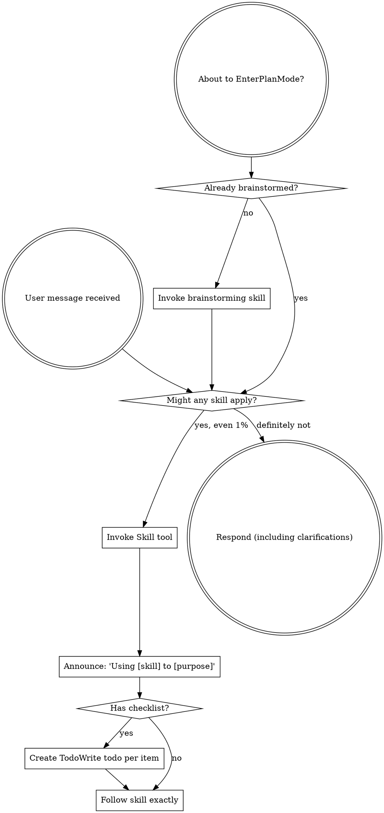

<SUBAGENT-STOP>
如果你被派去执行某个特定任务，跳过这个技能。
</SUBAGENT-STOP>

<EXTREMELY-IMPORTANT>
如果你认为某个技能有哪怕1%的概率会应用到你正在做的事情上，你绝对必须调用该技能。

如果某项技能适用于你的任务，你没有选择。你必须使用它。

这不可协商。这不是可选的。你无法用理性来逃避这一切。
</EXTREMELY-IMPORTANT>

## 指令优先级

超能力技能覆盖默认系统提示行为，但**用户指令始终优先考虑**：

1. **用户的显式指令**（CLAUDE.md、GEMINI.md、AGENTS.md、直接请求）——最高优先级
2. **超能力技能**——在冲突时覆盖默认系统行为
3. **默认系统提示** — 最低优先级

如果 CLAUDE.md、GEMINI.md 或 AGENTS.md 说“不要使用TDD”，而技能提示“始终使用TDD”，请按照用户的指示操作。用户掌控一切。

## 如何获取技能

**用Claude代码：** 使用“技能”工具。当你调用技能时，其内容会加载并呈现给你——直接跟随它。千万不要用技能文件的读取工具。

**在Copilot CLI中：** 使用“技能”工具。技能是通过安装的插件自动发现的。“技能”工具的工作原理和Claude Code的“技能”工具一样。

**在Gemini CLI中：**技能通过“activate_skill”工具激活。Gemini在会话开始时加载技能元数据，并按需激活全部内容。

**在其他环境中：** 查看你平台的文档，了解技能是如何加载的。

## 平台改编

技能使用Claude代码的工具名称。非CC平台：请参见“references/copilot-tools.md”（Copilot CLI）和“references/codex-tools.md”（Codex）获取工具等价物。Gemini CLI 用户通过 GEMINI.md 自动加载工具映射。

# 运用技能

## 规则

**在任何回应或行动之前，先调用相关或请求的技能。** 即使有1%的概率技能应用，也意味着你应该调用该技能来检查。如果某个技能在当前情况下被发现不适用，你也不需要使用它。

## 红旗

这些想法意味着“停下”——你在自我合理化：

|思考 |现实 |
|---------|---------|
|“这只是个简单的问题” |问题就是任务。检查技能。|
|“我需要更多背景信息” |技能检查是在澄清问题之前进行的。|
|“让我先探索一下代码库” |技能告诉你如何探索。先查查。|
|“我可以快速检查git/files” |文件缺乏对话上下文。检查技能。|
|“让我先收集信息” |技能告诉你如何收集信息。|
|“这不需要正式的技能” |如果有技能，就用它。|
|“我记得这项技能” |技能会不断进步。请阅读当前版本。|
|“这不算任务” |行动=任务。检查技能。|
|“技巧太过分” |简单的事情变得复杂。用它吧。|
|“我先做这件事” |做任何事前都要先确认一下。|
|“这感觉很有意义” |无纪律的行为浪费时间。技能阻止了这一点。|
|“我知道那是什么意思” |了解这个概念≠运用这项技能。调用它。|

## 技能优先

当多种技能可以同时应用时，请按以下顺序操作：

1. **流程技能优先**（头脑风暴、调试）——这些决定了如何完成任务
2. **实现技能其次**（前端设计，MCP构建者）——这些指导执行

“让我们打造X”→先头脑风暴，然后是实施技能。
“修复这个bug”→先调试，然后是领域专属技能。

## 技能类型

**刚性**（TDD，调试）：完全跟随。不要因为纪律而随意适应。

**灵活**（模式）：根据情境调整原则。

技能本身会告诉你哪种。

## 用户说明

说明书上写的是“做什么”，而不是“怎么做”。“添加X”或“修正Y”并不意味着跳过工作流程。